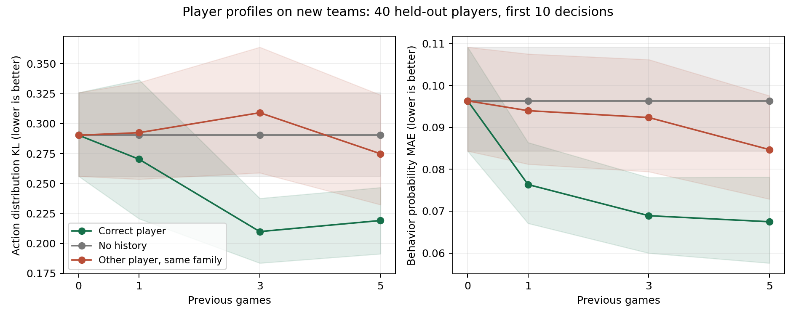
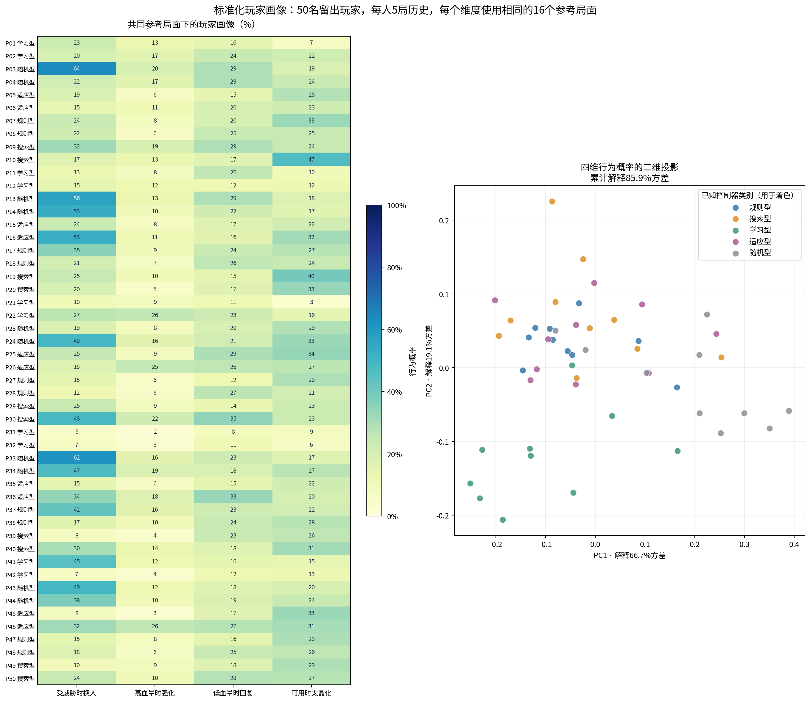

# Game Agent

面向 Pokémon Showdown 的博弈智能体研究项目，主要研究 Gen 9 OU 下的快速决策、策略记忆与对手建模。

## 项目结构

| 模块 | 内容 | 入口 |
|---|---|---|
| 对手建模 | 配置、战斗状态、信息记忆和动态策略的联合推断 | `src/arena/opponent/joint/` |
| System 1 | 本地决策模型、动作监督微调与 PPO | `src/arena/s1/`、`scripts/s1_action_train.py` |
| HyMem | 策略规划、跨回合记忆、执行协调与搜索融合 | `src/arena/agents/hymem/`、`src/arena/agents/fusion/` |
| 对战框架 | 统一观测、智能体注册、配队、对局调度和终端界面 | `src/arena/`、`configs/experiments/` |
| 外部方法 | Foul Play、Metamon、PokéChamp 和 PokeLLMon 的桥接与复现脚本 | `external/` |
| 领域知识 | 宝可梦资料、统计配置先验、队伍和规则定义 | `data/` |
| 研究结果 | 主实验、玩家记忆实验与二维玩家画像 | `results/` |

## 对手建模

模块维护四类变量的联合信念：

- **C：初始配置**。队伍、招式、道具、特性、性格、努力值、个体值与太晶属性。
- **X：战斗状态**。血量、PP、锁招、道具消耗与交换、状态和能力变化。
- **M：信息记忆**。对手合法可见的历史及其编码表示。
- **Z：策略状态**。行为原型、连续策略表示与策略变化。

神经网络采用 8 层、256 维的带记忆因果 Transformer，包含配置生成、动态策略、条件行动和推断提议四类计算。序贯蒙特卡洛过滤器将网络概率与 Showdown 机制观测相结合，逐步更新联合假设。默认预算为 1,024 个粒子、128 个配置候选。

输入包含赛制、队伍预览、公开事件和观察方合法掌握的私有信息。对手决策通道使用对手可知的信息。每个决策点先预测，再读取实际动作与结算事件并更新；新一局重置配置和战斗状态，只继承玩家级策略记忆。

`JointOpponentModel` 提供 `update`、`predict`、`query`、`sample_joint`、`condition`、`forecast`、`new_game`、`snapshot` 与 `restore` 接口。`dossier()` 输出可阅读的 JSON 资料卡，包含配置预测、当前状态、行为倾向和行动分布。底层查询同时提供概率、候选覆盖和推断状态。

## 安装

建议使用 Python 3.11、Node.js 和支持 CUDA 的 PyTorch。训练与完整推断需要另行准备模型权重和数据。

```bash
python -m venv .venv
source .venv/bin/activate
pip install -e '.[s1,s1-gpu,opponent,viz]'
cp .env.example .env
```

Showdown 放在与本仓库同级的 `pokemon-showdown/`。当前规则记录对应提交 `1636bf6d0848fb3c9330576963a647d4e179d278`。

```bash
git clone https://github.com/smogon/pokemon-showdown.git ../pokemon-showdown
git -C ../pokemon-showdown checkout 1636bf6d0848fb3c9330576963a647d4e179d278
(cd ../pokemon-showdown && npm install && npm run build)
```

对手模型直接调用本地模拟器。运行智能体对战时，另开一个终端启动服务器：

```bash
cd ../pokemon-showdown
node pokemon-showdown start --no-security
```

基础对战与终端界面：

```bash
arena run configs/experiments/quick_baselines.yaml
arena tui
```

模型服务地址在 `configs/models/registry.yaml`，密钥放在 `.env`。本地模型路径、队伍池和训练数据路径按实际环境修改。外部方法通过各自的 `external/<method>/setup.sh` 安装；桥接协议见 [external/README.md](external/README.md)。

## 对手模型的数据与训练

训练数据由两部分构成：

| 数据来源 | 可用监督 |
|---|---|
| 本地受控对局 | 双方合法视角、提交动作、完整配置、状态轨迹和控制器分布 |
| Metamon / PokéChamp 公开回放 | 公开事件、实际可见动作及已揭示配置；缺失隐藏标签保持缺失 |

原始数据、派生训练集和模型权重放在 `artifacts/`、`models/` 或 `runs/`。这些目录不随代码发布。

配置目录由 Showdown 完整配招和 Foul Play 队伍组合构建。准备相应 JSON 后执行：

```bash
python scripts/opp_joint_catalog.py \
  --sets /path/to/showdown_sets/gen9ou.json \
  --teams /path/to/foulplay/gen9ou/teams.json
node scripts/node/opp_joint_catalog.js artifacts/opponent_joint
python scripts/opp_joint_generate.py --workers 12
```

`opp_joint_generate.py` 的默认预算为 40 万局；`--groups` 可限制每个数据分区的生成组数。规则合法性由本地 Showdown 校验。

人类回放转换器读取 `artifacts/opponent_data/metamon/` 和 `artifacts/opponent_data/pokechamp/` 下已准备的 `manifest.json`、`battles.parquet` 索引及原始 Parquet 文件。`manifest.json` 的 `files[].path` 指向源文件，索引记录对局身份、时间、玩家和源行位置。下载与初始索引需要单独准备。

```bash
python scripts/opp_joint_human_data.py --workers 6
python scripts/opp_joint_prepare_training.py --workers 8
torchrun --standalone --nproc_per_node=2 scripts/opp_joint_train.py \
  --epochs 0 --min-epochs 5 --batch 256
```

`--epochs 0` 按验证集平台期停止。训练脚本支持断点续训及学习率调整，主检查点写入 `artifacts/opponent_joint/training/model.pt`。玩家策略先验的训练与校准入口为 `scripts/opp_joint_adaptation.py`；完整过滤评测默认读取 `training/adaptation/model.pt`。

准备好检查点与 `catalog.json` 后，将合法观察历史写为输入 JSON：

```bash
python scripts/opp_joint_predict.py \
  --input /path/to/history.json \
  --output /path/to/opponent.json \
  --model artifacts/opponent_joint/training/adaptation/model.pt \
  --device cuda:0
```

输入字段定义见 [opponent-joint-input.json](data/schemas/opponent-joint-input.json)。底层联合信念结构见 [opponent-joint.json](data/schemas/opponent-joint.json)，面向阅读的资料卡由 `src/arena/opponent/joint/dossier.py` 组织。

## 独立对手建模评测

核心指标为隐藏招式 Recall@k、隐藏道具/特性/太晶 Top-k、下一提交动作 Top-k 与 NLL。只计入决策时尚未公开的配置；不支持的预测项目保留为空，预测失败计入分母。

完整联合模型的匹配评测入口：

```bash
python scripts/opp_joint_public.py --split test \
  --start-group 70 --groups 14 --games 2 \
  --output artifacts/opponent_joint/training/joint_validation --workers 2
```

原生配置预测 baseline 由 `opp_baseline_topk.py` 和各外部项目的预测脚本处理；LLM baseline 使用 `opp_qwen27b.py`。玩家行为画像与换队迁移实验按顺序执行：

```bash
python scripts/opp_profile_transfer.py prepare
python scripts/opp_profile_transfer.py support --workers 4
python scripts/opp_profile_transfer.py match
python scripts/opp_profile_transfer.py query --workers 4
python scripts/opp_profile_transfer.py report
python scripts/opp_profile_visualization.py
```

该实验固定后续新队伍对局，比较正确玩家历史、无历史和其他玩家历史，使用前 0、1、3、5 局记忆，按玩家计算配对置信区间。

## 已保存的结果

主实验使用相同的 14 名受控玩家、28 个完整玩家对局，包含 978 个非预览提交动作。配置指标覆盖 17,689 个尚未公开招式、4,300 个道具、4,161 个特性和 5,303 个太晶属性目标。完整 Top-1/3/5、协议与运行统计见 [baselines.json](results/baselines.json)。

| 方法 | 隐藏招式 Recall@3 | 隐藏道具 Top-1 | 隐藏特性 Top-1 | 隐藏太晶 Top-1 | 提交动作 Top-1 |
|---|---:|---:|---:|---:|---:|
| Joint C/X/M/Z filter | 76.53% | 78.65% | 96.20% | 50.88% | 41.00% |
| Current neural prediction heads | 73.50% | 67.84% | 95.53% | 43.20% | 23.82% |
| Foul Play native tracker + set sampler | 70.77% | 70.28% | 94.30% | 36.13% | — |
| Metamon NaiveUsagePredictor | 65.85% | 56.21% | 94.71% | 40.17% | — |
| PokéChamp BayesianTeamPredictor | 66.62% | 52.77% | 94.71% | 43.75% | — |
| PokéChamp opponent prompt + Qwen3-8B | — | — | — | — | 24.13% |
| PokéChamp opponent prompt + Qwen3.8-27B | — | — | — | — | 25.56% |
| Pure Qwen3.8-27B | 26.21% | 15.53% | 40.62% | 22.59% | 24.03% |

玩家记忆实验的主分析为 40 名未参与训练的非随机玩家；另有 10 名随机控制器作为对照。使用前 5 局历史，预测固定新队伍对局的前 10 次决策：

| 跨局记忆 | 行动 NLL ↓ | 行动分布 KL ↓ | 画像 MAE ↓ | 行动 Top-1 ↑ |
|---|---:|---:|---:|---:|
| 正确玩家历史 | 1.4530 | 0.2191 | 0.0675 | 46.75% |
| 无历史 | 1.5154 | 0.2903 | 0.0963 | 45.25% |
| 其他玩家历史 | 1.5107 | 0.2748 | 0.0847 | 47.25% |

正确玩家记忆改善了行动分布和行为画像。完整历史长度曲线、前 5 次决策结果与配对置信区间见 [player_memory.json](results/player_memory.json)。



在共同参考局面下比较不同玩家的预测行为倾向，展示换人、强化、回复和太晶使用概率的差异。数值见 [player_profiles.json](results/player_profiles.json)。



## 已知限制

当前主要匹配实验与玩家记忆实验使用受控玩家，外部人类回放提供另一类训练和评测监督。28 个玩家对局的主实验规模有限。神经网络直接预测与联合过滤采用不同的行动预测头，因此该主实验支持整体系统比较，不能单独归因于粒子过滤或配置与策略的耦合。跨局记忆的 Top-1 尚未呈现稳定提升，收益主要体现在概率分布和画像误差。
