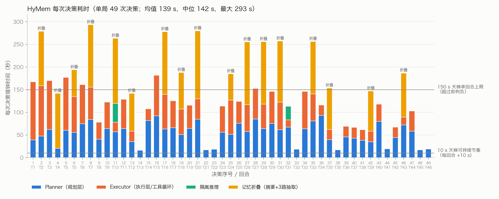
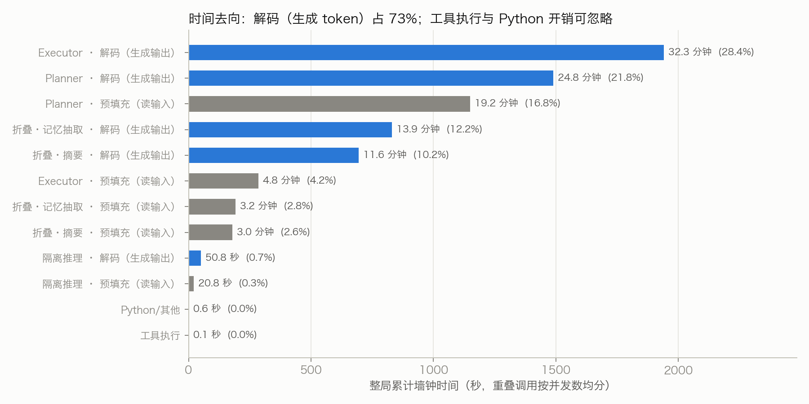
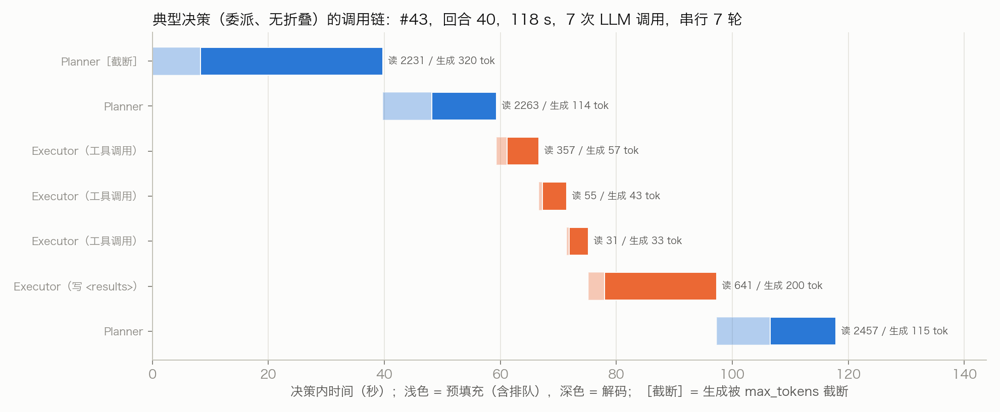
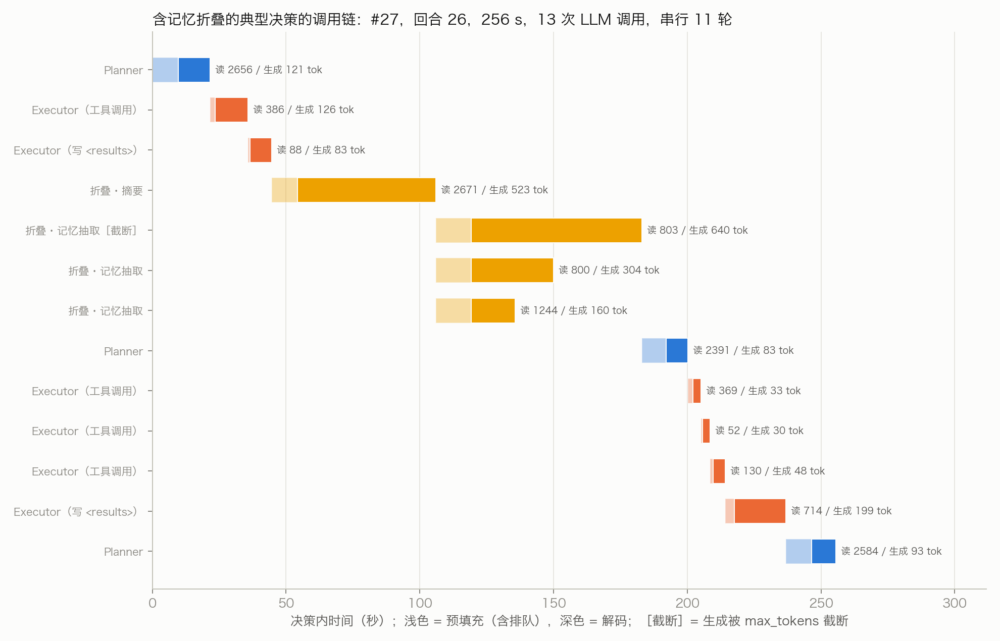
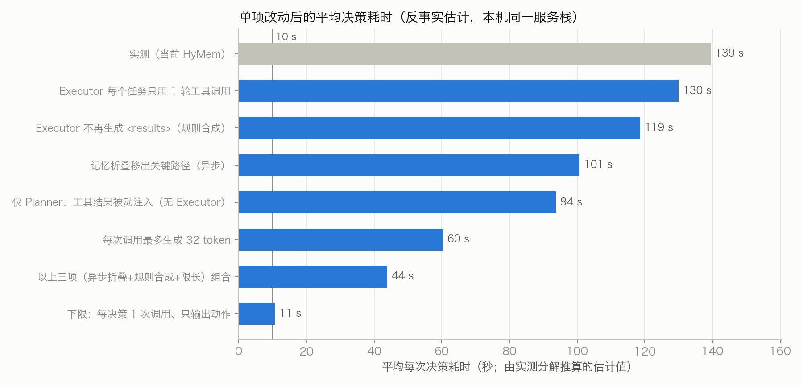

# HyMem 博弈智能体实时性测试与原因分析

> 测试日期：2026-10-23 · 一局完整对战（gen9randombattle，46 回合，49 次决策）· 本地 Qwen3.5-4B（mlx_lm，Apple M4）
> 对手为 `random`，只用于把对局推进下去，本报告**不评价胜负**。
> 原始数据：`runs/hymem_latency_randbats/`（每次决策、每次 LLM 调用、每次工具调用的时间戳）；`runs/_latency/`（服务端日志、推理基准、内存采样）。

## 结论速览

1. **实时性远不达标。** 49 次决策平均 **139.5 s**（中位 141.7 s，p90 258.7 s，最大 293.5 s），没有一次在 10 s 以内。整局 46 回合共用 **114 分钟**。
   - 按 Showdown 天梯计时规则（单回合上限 150 s），**第 1 回合就会超时判负**；按 arena 机器人对战使用的挑战规则（单回合上限 300 s），**第 2 回合判负**。
   - 这局 46 回合在天梯规则下最多可用约 675 s，实际用了 6,835 s，约为预算的 **10 倍**。
2. **时间几乎全部花在 LLM 推理上**：解码（生成 token）占 **73%**，预填充（读入 prompt）占 **27%**。工具执行全局合计 0.1 s，Python 开销 0.6 s，等待服务器/对手 0.6 s，都可以忽略。
3. **根因是两件事相乘**：HyMem 每个回合都要把完整的分层串行链路走一遍，而本机生成 token 很慢。
   - **链路长**：每次决策平均 **7.9 次 LLM 调用、7.2 轮串行**（planner → executor 多轮工具调用 → `<results>` → planner → …）。
   - **生成多**：每次决策生成约 **1,218 token**。本机生成 1 个 token 约 98 ms，是读入 1 个 token（约 2.7 ms）的 **36 倍**。
   - **记忆折叠阻塞决策**：35% 的决策触发了折叠，每次约 112 s，合计占总时间 **28%**。论文的触发阈值（如"自上次折叠起 ≥10 次工具调用"）在对战里每 2–3 次决策就满足一次，而折叠是同步执行的。
   - **生成的 token 去向**：40% 来自折叠，34% 来自 executor（XML 工具调用和 `<results>`），25% 来自 planner。planner 的输出里 **78% 是 `<analysis>`**，按类型化隔离的设计它生成后即被丢弃。
4. **方法层改进能大幅降低延迟，但到不了实时。** 以下数字由实测分解推算：
   - 单项收益最大的是"每次调用最多生成 32 token"，平均降到约 60 s。
   - "异步折叠 + executor 规则合成 + 32 token 上限"三项组合后，平均约 44 s。
   - **即使每回合只调用 1 次 LLM、只输出动作，本机下限也约 10.6 s**，因为读完约 3.5k token 的 planner prompt 就要约 9.4 s。
   - 不改结构时，要把平均延迟压到 10 s，推理服务需提速约 **14 倍**；在上述组合改动之后，仍需约 4.4 倍。

---

## 1. 测试设置与测量方法

| 项目 | 设置 |
|---|---|
| 对局 | gen9randombattle 单局；对手 `random`（仅作驱动）。46 回合，49 次决策，其中 3 次是同回合强制换人 |
| 模型服务 | Qwen3.5-4B（bf16，混合 Gated DeltaNet / 注意力），`mlx_lm.server` 0.31.3，非思考模式，T=0.7、top_p=0.8、top_k=20。测试期间服务独占，没有其他对局或基准并发 |
| 硬件 | Apple M4（基础版），统一内存 32 GB |
| 智能体 | `llm_hymem` + `configs/hymem/mac.yaml`：planner_steps=3，execute_turns=3，每次决策最多 1 次隔离推理，规则路由，两阶段折叠，replan 关闭 |
| 折叠触发 | 论文 Eq.17：n_tool≥10、n_exec≥5、n_turn≥8、n_fail≥3、r_ctx>0.99；min_turns_between_folds=5 |
| 生成上限（max_tokens） | planner 320 / executor 256 / 隔离推理 512 / 折叠摘要 768 / 记忆抽取 640 |

**测量了什么**：
- 每次 LLM 调用的起止时间、prompt token 数、缓存命中 token 数、生成 token 数和 finish_reason；
- mlx 服务端日志里每个请求的"预填充完成"时间戳。日志中进度行的分母就是该请求未命中缓存的 token 数，据此可以精确对应到每次调用；
- 每次工具调用和观测蒸馏的耗时；
- 每次决策的起止时间；
- 每 15 s 一次的内存/交换采样。

**怎么分解**：
- 每次调用拆成两段："预填充（含排队）"= 发出请求到服务端预填充完成；"解码"= 预填充完成到返回。
- 同一决策内多个调用并发时，按并发数均分重叠时间。
- 这样每次决策各部分之和恰好等于它的墙钟时间。

**测量是否可信**：
- 用独立基准拟合的成本模型（§1.2）去预测 338 次无重叠调用的耗时，平均绝对误差 1.3 s（实测均值 17.2 s）。
- 实测解码速度中位数 10.1 tok/s，与基准的 10.3 tok/s 一致。

### 1.1 "实时"的标准：Showdown 计时器（本地服务器 `server/room-battle.ts`）

| 规则 | 初始时间库 | 每回合增加 | 单回合上限 | 本局（46 回合）最多可用 |
|---|---|---|---|---|
| 天梯（ladder） | 150 s + 60 s 宽限 | +10 s（时间库上限 150 s）；同回合额外请求 +5 s | 150 s | ≈ 675 s |
| 挑战（challenge，arena 机器人对战方式） | 300 s + 60 s 宽限 | +10 s | 300 s | ≈ 825 s |

计时按 5 s 为一跳扣减。超过单回合上限或时间库耗尽，即判"lost due to inactivity"。初始时间库用完以后，可持续的节奏大约是 **每回合 10 s**。

### 1.2 本机推理服务的"物理参数"（`scripts/bench_llm_latency.py`，测试前单独运行）

| 指标 | 实测 |
|---|---|
| 预填充（读 prompt） | 367 tok/s，即每 1k 未缓存 token 约 2.7 s，到 8k 仍保持线性 |
| 解码（生成） | 10.3 tok/s，1k 与 4k 上下文几乎相同；约为理论上限（M4 标称带宽 120 GB/s ÷ 8.4 GB 权重 ≈ 14 tok/s）的 73% |
| 每 token 成本 | 生成约 98 ms，读入约 2.7 ms，相差 **36 倍** |
| 前缀缓存 | 同一个 prompt 再发一次：5.6 s → 0.3 s。system 前缀相同、user 段换新：只处理新的那段 |
| 并发 | 预填充不会因并发变快：3 路并发时每路等首 token 约 13 s，单路约 4.5 s。解码可以批处理，每路仍约 10.3 tok/s |

---

## 2. 结果

### 2.1 每次决策耗时



| 决策类型 | 次数 | 平均 | 范围 | 典型构成 |
|---|---|---|---|---|
| 直接作答（只有 1 次 planner 调用） | 8 | 17.9 s | 16–19 s | 读入约 3.5k token，生成约 125 token |
| 委派、无折叠 | 24 | 122.3 s | 62–182 s | 约 7.9 次串行调用，生成约 900 token |
| 含记忆折叠 | 17 | 221.0 s | 142–293 s | 在上一行基础上再加约 112 s 的折叠 |
| **全部** | **49** | **139.5 s** | 16–293 s | 7.9 次调用、7.2 轮串行，生成 1,218 token，读入 9.8k 未缓存 token |

只有 8 次直接作答在 30 s 以内，占 16%。59% 的决策在 150 s 以内，换句话说 **41% 的决策单次就超过了天梯单回合上限**。

### 2.2 时间花在哪里



| 上下文空间 | 墙钟时间 | 占比 | 其中预填充 / 解码 |
|---|---|---|---|
| Planner（规划层） | 44.0 min | 38.6% | 19.2 / 24.8 min |
| Executor（执行层） | 37.1 min | 32.6% | 4.8 / 32.3 min |
| 记忆折叠（摘要 + 3 路抽取） | 31.6 min | 27.8% | 6.2 / 25.4 min |
| 隔离推理 | 1.2 min | 1.0% | 0.3 / 0.8 min |
| 工具执行 / Python / 等待对手 | 0.1 s / 0.6 s / 0.6 s | ≈ 0% | — |

| 调用类型 | 次数 | 每次决策 | 输入 token（缓存命中率） | 生成 token | 平均耗时 |
|---|---|---|---|---|---|
| Planner | 121 | 2.47 | 3,505（24%） | 125 | 21.8 s（预填充 9.5 + 解码 12.3） |
| Executor：工具调用轮 | 133 | 2.71 | —（87%） | 79 | 9.0 s |
| Executor：写 `<results>` | 65 | 1.33 | —（78%） | 145 | 15.8 s |
| 折叠：摘要 | 17 | 0.35 | 3,858（23%） | 416 | 51.4 s |
| 折叠：记忆抽取（3 路并发） | 51 | 1.04 | 847（3%） | 332 | 44.7 s（其中约 8.9 s 是排队） |
| 隔离推理 | 2 | 0.04 | 2,872（0%） | 256 | 35.8 s |

### 2.3 一次决策内部发生了什么



上图是一次典型的委派决策（#43，118 s）：

1. planner 第 1 步写分析写到 320 token 的上限，没写出指令，**这一步作废**（约 40 s）；
2. 第 2 步下达任务；
3. executor 用 3 轮工具调用，再写一次 `<results>`；
4. planner 第 3 步作答。

7 次调用全部串行。工具本身的执行时间在图上看不到，只有毫秒级。



上图是一次含折叠的决策（#27，256 s）。决策进行到一半触发折叠，依次执行：

1. 先写约 523 token 的状态摘要（约 60 s）；
2. 再并发做 3 路 JSON 抽取。三路的预填充串行完成，所以要一起等待；最长的一路生成到 640 上限被截断，它决定了这一段的长度。

折叠在关键路径上占了约 140 s，之后 planner 才继续委派和作答。

### 2.4 计时器回放

| 规则 | 判负位置 | 原因 |
|---|---|---|
| 天梯 | 第 1 回合（第 1 次决策） | 本次决策 167 s，超过单回合上限 150 s |
| 挑战 | 第 2 回合（第 2 次决策） | 第 1 次决策耗时 167 s（按 5 s 一跳扣 165 s），时间库剩 195 s；第 2 回合补 10 s 到 205 s，而第 2 次决策用了 279 s |

### 2.5 排除项：哪些*不是*原因

- **工具执行**：201 次工具调用合计 0.11 s，单次最长 10 ms。
- **Python 胶水与等待**：Python 开销 0.6 s，等待服务器/对手 0.6 s。整局墙钟 6,835.3 s 中，6,834.8 s 都是我方在决策。
- **内存压力**：这台机器上其他应用占用较多内存，交换区约 13.9 GB。但模型进程始终常驻（8.0–8.4 GB），整局换入只有约 113 MB，实测解码速度与独立基准一致，所以不影响结论。
- **服务器争用**：本局独占推理服务。作为对照，10 月 20 日那局与另外两局对战共享同一个 mlx 服务，平均每次决策 212.7 s。两局的折叠间隔配置不同，这个数字只作参考，但它说明多局并行会让单局更慢。

---

## 3. 实时性差的原因（按影响排序）

### 原因 1：每个回合都要把完整的分层串行链路走一遍（结构性）

- **任务形态不同**：HyMem 面向的是"一个任务只在最后回答一次"的长程任务。在 GAIA / BrowseComp 中，先做几十步工具调用，最后给一个答案，任务级耗时以分钟计也可以接受。对战则要求**每个回合都给出答案**：本局一个任务（即一局）里要回答 49 次。于是 HyMem 的每步固定开销（规划、委派、执行、回传、再规划）被乘以了回合数。
- **委派频繁**：
  - 55% 的决策里，planner 先后委派了 **2 个任务**才作答（`task,task,answer` 23 次，`task,task,none` 4 次）。
  - 只有 9 次（18%）在第一步就直接作答，其中 8 次只用约 18 s。
  - 每个任务平均又要 2.1 轮工具调用，外加约 1 次 `<results>`。
- **全串行**：每次决策 7.9 次调用、7.2 轮串行。后一次调用依赖前一次的结果，几乎无法并行；即使单次调用平均只要约 17 s，链条一长就是两分钟。

### 原因 2：生成量大，而本机生成极慢（解码占 73%）

每次决策生成 1,218 token，整局共 59,662 token。本机解码 10.3 tok/s，生成 1 个 token 的时间是读入 1 个 token 的 36 倍，所以**"写多少"比"读多少"重要得多**。生成的 token 去向如下：

- **记忆折叠，40%**：摘要平均 416 token；三路 JSON 抽取各约 332 token，其中 5 次触顶 640 被截断。
- **Executor，34%**：
  - 工具调用平均 79 token/轮。Qwen3.5 的 XML 工具调用格式本身就冗长：同一个 `damage_calc` 调用写成 XML 约 59 token，写成 JSON 约 37 token。
  - `<results>` 块平均 145 token。
- **Planner，25%**：其中 78%（约 98 token/次）是 `<analysis>`。在类型化隔离下 analysis 不进入 H^p，它的作用只相当于一次性的思维链，却每步要花约 10 s。

**截断造成的浪费**：planner 有 9 次触顶 320，这 9 步**全都没写出指令、整步作废**，共浪费 367 s，占全局 5.4%。executor 有 8 次、记忆抽取有 5 次触顶。

### 原因 3：记忆折叠同步阻塞决策，且在对战中触发过于频繁

- **频率与成本**：49 次决策中有 17 次（35%）触发折叠，每次平均 112 s（58–150 s），合计占总时间 28%。
- **触发阈值不适配**：
  - 触发原因分布：工具调用数 ≥10 共 12 次，executor 调用数 ≥5 共 3 次，planner 轮数 ≥8 共 2 次。
  - 这些阈值来自论文的 GAIA 设置。对战中每次决策约 4 次工具调用，2–3 次决策就满足一次。
- **同步执行**：当前决策必须等"摘要 → 3 路抽取"全部完成才能继续。
  - 3 路抽取虽然并发，但本机预填充不能并行，每路平均排队约 9 s。
  - 这一段的总时长由最长的一路决定，而最长的一路常被 640 上限截断。

### 原因 4：Executor 的多轮工具循环，且工具粒度过细

- **轮数多、每轮调得少**：每个任务平均 2.1 轮工具调用加 1 次 `<results>`，约 3.1 次调用、37 s；每轮平均只调用 1.5 个工具。
- **偏好细粒度工具**：
  - 调用次数：`damage_calc` 96、`type_matchup` 46、`pokedex_lookup` 28、`switch_eval` 21、`opponent_sets` 10。
  - **一次就能返回伤害、速度、免疫全部信息的 `matchup` 工具，以及 `speed_check`，一次都没用过。**
  - planner 下达的任务也常常一句话要求多项计算，进一步拉长了循环。
- **`<results>` 合成调用成本高**：
  - 它不带工具定义，导致 system 段变化，缓存命中率只有 78%（工具调用轮为 87%）。
  - 它只是把工具结果再"转述"一遍：平均 145 token、15.8 s。

### 原因 5：Planner 每一步都要重读约 3.5k token

- **构成**：planner prompt 平均 3,505 token。其中 system（指令 + 简报）860，记忆 1,261，历史 H^p 952，当前局面 139，合法动作与指令 276。
- **设计目标达成，但缓存利用不足**：
  - HyMem 的折叠确实把 planner prompt 控制在 4k 以内，这一点达到了设计目标。
  - 但只有 system 段（约 846 token）能命中前缀缓存。记忆和历史放在每一步都会重建的 user 段里，所以每次 planner 调用都要重新预填充约 2.7k token（约 9.5 s）。
  - planner 的预填充占总时间 17%。
- **下限的来源**：这也是前面"下限 10.6 s"的来源。哪怕只调用一次，读完这份 prompt 就要约 9.4 s。

### 原因 6：硬件与推理服务的基线速度

- **硬件速度**：Apple M4 上的 bf16 4B 模型，解码 10.3 tok/s，预填充 367 tok/s。
- **算力共享**：单个推理服务的所有调用共享一份算力，并发请求的预填充只能排队。
- **所需提速**：在当前调用结构下，平均做到 ≤10 s 需要约 14 倍的服务速度，≤30 s 需要约 4.6 倍，≤60 s 需要约 2.3 倍。**仅靠硬件或仅靠方法改动都不够**，两者都要做。

---

## 4. 改进方向与收益估计（本次未实施）



| 改动（单项，除注明外） | 平均决策耗时（估计） | 变化 |
|---|---|---|
| 实测（当前 HyMem） | 139.5 s | — |
| Executor 每个任务只用 1 轮工具调用 | 129.9 s | −7% |
| Executor 不再生成 `<results>`（改为规则合成） | 118.6 s | −15% |
| 记忆折叠移出关键路径（异步执行） | 100.8 s | −28% |
| 只保留 Planner：工具结果被动注入（不用 Executor） | 93.7 s | −33% |
| 每次调用最多生成 32 token | 60.3 s | −57% |
| 组合：异步折叠 + 规则合成 + 32 token 上限 | 43.8 s | −69% |
| 下限：每回合 1 次调用、只输出动作 | 10.6 s | −92% |

**估计方法与局限**：
- 在实测分解上去掉或缩放相应部分，例如按比例缩短超出 32 token 那部分的解码时间，并假设其余过程不变。
- 这些数字不反映改动对决策质量的影响，也不反映模型行为因此发生的变化。
- 异步折叠在单 GPU 上仍要占用预填充算力（每次约 5k token，约 15 s）。好在解码可以与其他请求批处理，几乎不增加时延。

**改进方向（按收益/成本排序）：**

1. **压缩生成**（单项收益最大）：
   - planner 不写或只写极短的 analysis，直接输出指令或动作编号；
   - executor 输出紧凑；
   - 记忆 JSON 精简字段和条数；
   - 为每个空间设置合适的 max_tokens，同时避免"截断即作废"（如允许截断后补出指令）。
2. **让折叠适配对战节奏**：
   - 按回合数或上下文实际占用来触发，而不是按工具调用次数；
   - 异步执行（例如利用对手思考的时间），或交给规则/更小的辅助模型完成。
3. **减少串行轮数**：
   - 常用计算（matchup、伤害、速度、换人评估）在每回合开始时由规则预计算，被动注入给 planner，执行只需毫秒级；
   - 只把真正需要推理的问题交给隔离推理；
   - executor 一次性并行调用工具，结果由规则合成。
4. **稳定前缀、提高缓存命中**：把每回合变化少的内容（简报、记忆）放进固定前缀，当前局面和选项放在最后，让 planner 每步只预填充新增部分。
5. **时间预算感知（anytime）**：
   - 给每回合设硬性截止时间，例如依据 Showdown 计时器的剩余时间；到点就用当前最佳动作作答；
   - "显然"的回合直接作答，本局直接作答约 18 s。
6. **更快的推理服务**：
   - 可选手段：GPU 服务器上的 vLLM、量化，或给执行层/辅助任务换更小的模型；
   - 当前结构下要做到平均 10 s 约需提速 14 倍；做完上面的组合改动后约需 4.4 倍；
   - 在 GPU 服务器上可以用同一套脚本复测：`bench_llm_latency.py` + 本局配置 + `analyze_latency.py`。

---

## 5. 硬件无关的方法层分解：不考虑本机推理限制，延迟来自哪里

在任何推理服务上，一次决策的耗时都可以近似写成：

> 每次决策耗时 ≈ 串行轮数 × 每轮固定开销 + 关键路径生成 token ÷ 解码速度 + 未缓存输入 token ÷ 预填充速度

三个"量"由方法框架决定，硬件只决定三个"速度"。下表是本局每次决策的平均工作量，按 HyMem 的机制归类。并发调用（3 路记忆抽取）在关键路径上只计最长的那一路。

| 机制 | 串行轮数 | 关键路径生成 token | 未缓存输入 token |
|---|---|---|---|
| 基线：每回合必需的一次规划（planner 第一步） | 1.00（14%） | 112（11%） | 2,641（27%） |
| **分层委派往返**（executor 工具轮 + 写 `<results>` + planner 读取结果再规划 + 隔离推理） | **5.37（74%）** | **557（53%）** | 4,764（49%） |
| **同步记忆折叠**（摘要 + 最长一路抽取） | 0.69（10%） | **314（30%）** | 1,896（19%） |
| 截断作废的 planner 步 | 0.18（2%） | 59（6%） | 467（5%） |
| **合计** | **7.24** | **1,042** | **9,768** |

把委派往返再拆开：

| 组成 | 串行轮数 | 生成 token |
|---|---|---|
| executor 工具调用轮 | 2.71 | 215 |
| executor 写 `<results>` | 1.33 | 193 |
| planner 读取结果后再走一步 | 1.29 | 139 |

**结论：**

1. **最大来源是分层委派造成的串行往返**，占串行轮数的 74%、关键路径生成量的 53%。
   - 每委派 1 个任务，平均增加 3.9 轮串行调用、408 个生成 token、3.5k 输入 token；本局每回合平均委派 1.37 个任务。
   - 其中"写 `<results>`"这一轮（每回合 1.33 轮、193 token）完全是类型化隔离（σ 合成）带来的：原始工具输出不允许进入 planner，所以执行层必须用 LLM 再生成一遍结果。
   - executor 的工具轮是在用 LLM 逐个生成工具调用；planner 用文字下达任务，执行层再把任务"翻译"成工具调用，同一个意图被生成了两次。
2. **第二大来源是同步的 LLM 记忆折叠**，占关键路径生成量的 30%。每次折叠是 2 轮串行、906 个生成 token；按当前触发阈值，平均每 3 回合就要折叠一次。
3. **planner 每一步的自由文本推理（`<analysis>`）**约 251 token/回合，占关键路径生成量的 24%。它分布在上面各个 planner 步里，按设计生成后即丢弃。
4. **截断作废**占 6%，属于实现问题。工具执行不消耗模型时间（全局 0.1 s）。

**与"只规划一次就作答"相比**：HyMem 框架带来约 **7 倍的串行轮数**、约 **9 倍的关键路径生成量**。

**换到更快的硬件上会怎样**：
- 预填充一旦足够快，输入项就降为次要，**生成 token 数和串行轮数**成为主导。
- 以平均每回合 1,042 个关键路径生成 token 计：解码 50 tok/s 时仅解码一项就需约 21 s，100 tok/s 约 10 s，200 tok/s 约 5 s；另外再加上 7.2 轮 × 每轮固定开销（首 token 延迟、网络、调度）。
- 同样条件下，"每回合 1 次调用、只输出动作"的策略只需不到 1 s。
- 这里的解码速度是示意参数，不是实测值。

**本质原因**：HyMem 用额外的 LLM 生成来换取规划上下文的干净，包括 σ 合成、planner 再规划和 Φ 折叠重写。在 GAIA 这类任务里，这些成本摊到一个最终答案上；在回合制对战中，**每个回合都要付一次**。

---

## 6. 复现

```bash
cd /Users/hoi/project/game/pokemonbot
bash scripts/serve_qwen35_mlx.sh > runs/_latency/mlx_server.log 2>&1 &     # 保留服务端日志（预填充时间戳）
python scripts/bench_llm_latency.py --model qwen3.5-4b-mlx --out runs/_latency/bench_llm_latency.json
(cd ../pokemon-showdown && node pokemon-showdown start --no-security) &
python -m arena.cli run configs/experiments/hymem_latency_randbats.yaml --emit-events
python scripts/analyze_latency.py runs/hymem_latency_randbats --server-log runs/_latency/mlx_server.log \
    --bench runs/_latency/bench_llm_latency.json --mem runs/_latency/mem_samples.log
python scripts/plot_latency_report.py runs/hymem_latency_randbats/latency/latency_summary.json --out reports/figures
```

**文件清单**

| 文件 | 内容 |
|---|---|
| `runs/hymem_latency_randbats/latency/latency_tables.md` | 全部明细表，含逐决策的分解（即本报告图表对应的表格） |
| `runs/hymem_latency_randbats/latency/latency_summary.json` | 机器可读的分析结果 |
| `runs/hymem_latency_randbats/latency/latency.html` | 交互图：逐决策分解、全局调用时间线、CDF |
| `runs/_latency/` | 基准结果、服务端日志、内存采样、对局输出 |
| `scripts/bench_llm_latency.py` | 推理服务基准 |
| `scripts/analyze_latency.py` | 延迟分析 |
| `scripts/plot_latency_report.py` | 本报告的插图 |
| `configs/experiments/hymem_latency_randbats.yaml` | 本次测试的实验配置 |
| `calls_<agent>.jsonl`（新增记录） | 每次调用的 `t_start` / `cached_tokens` / `finish_reason`；工具事件 `event:tool` |
| `traj_<agent>.jsonl`（新增记录） | 每次决策的 `t_start` / `t_end` / `llm_time_by_space` / `tool_time_s` |
